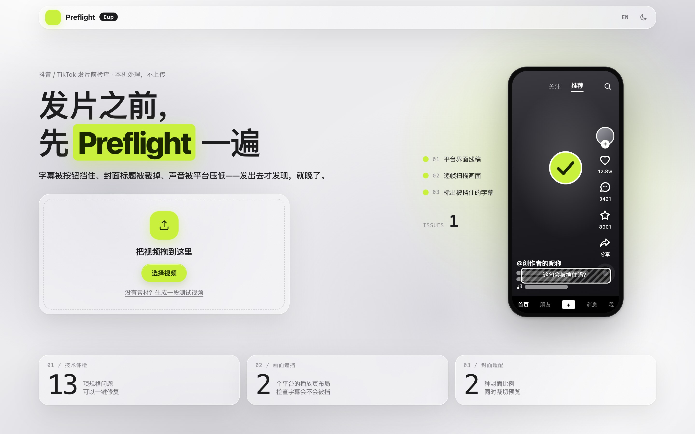
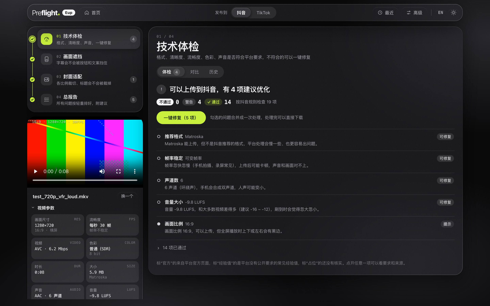
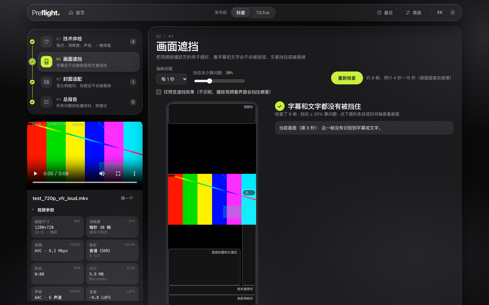
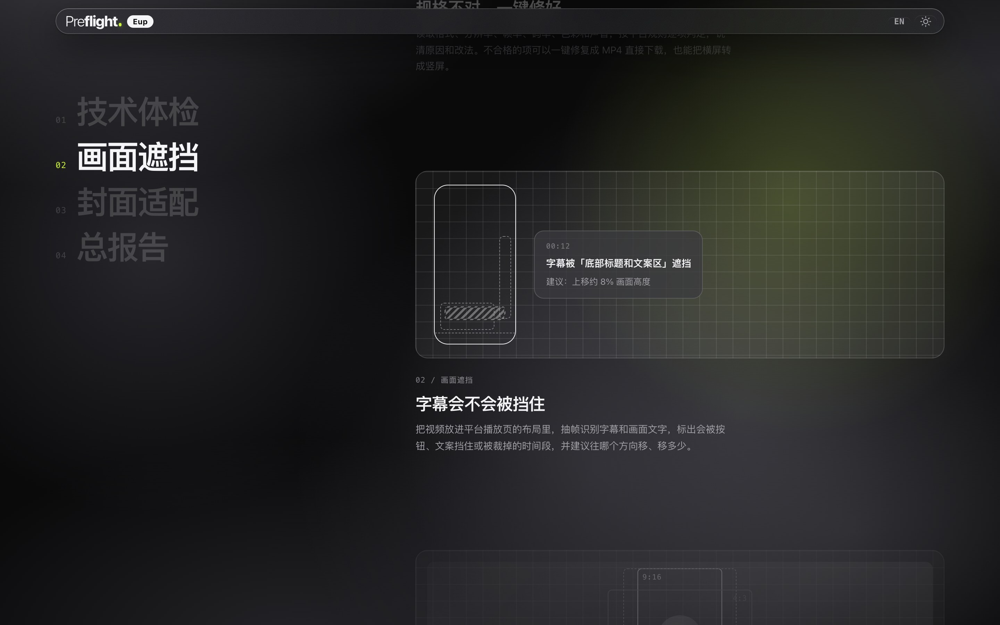
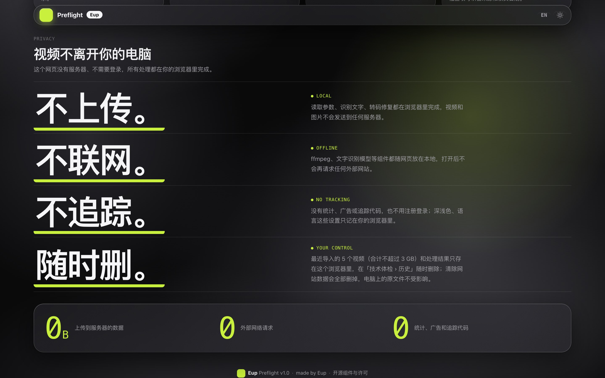
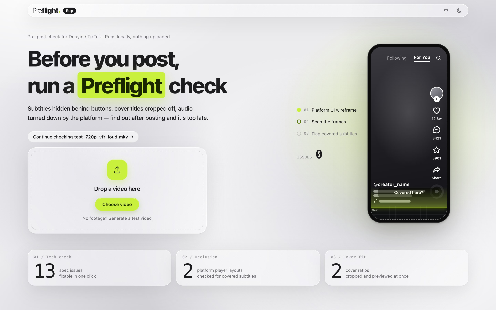

<div align="center">

# Eup Preflight

**发片之前，先 Preflight 一遍。**

短视频发布到 **抖音 / TikTok** 之前的一站式检查：技术规格、字幕会不会被平台界面挡住、封面在各个比例下是否适配——<br>
全部在浏览器里完成，视频**不上传、不联网、不追踪**。

[在线使用](https://eup-preflight-d6gz1q4ji14b7385a-1409272358.tcloudbaseapp.com/) · [开发说明](docs/开发说明.md) · [English](#english)



</div>

> 在线地址用的是腾讯云 CloudBase 的测试域名，打开时会先出现一个“风险提醒”页，点「确定访问」即可。

## 为什么做这个

字幕被右侧按钮挡住、封面标题在主页网格里被裁掉、音量被平台压低、可变帧率上传后音画不同步……这些问题往往发出去才发现。Eup Preflight 把平台的规格要求和播放页布局做成可检查的规则，在发布前一次查完，能修的直接修好。

## 能做什么

| | 步骤 | 做什么 |
|---|---|---|
| 01 | **技术体检** | 读取格式、分辨率、帧率、码率、色彩、声音，按平台规则逐项判定，说明原因和改法。不合格的项可以**一键修复**（13 项修复 + 横屏转竖屏），直接下载 MP4，并和原片对比前后变化。 |
| 02 | **画面遮挡** | 把视频放进平台播放页的布局里，抽帧识别字幕和画面文字，标出会被按钮、文案挡住或被裁掉的时间段，并建议“上移约 8% 画面高度”这样的调整；识别不到的花字可以手动框选。 |
| 03 | **封面适配** | 从视频选一帧或上传封面图，按平台用到的各个封面比例同时裁切预览，检查主体和标题有没有被裁掉、被角标挡住、够不够清晰，一次导出全部尺寸。 |
| 04 | **总报告** | 三步的结果按“不通过 / 警告 / 提示”排好，每条附原因、修改建议和“去修复”按钮。 |

<table>
  <tr>
    <td width="50%"><br><sub>技术体检：逐项判定，一键修复</sub></td>
    <td width="50%"><br><sub>画面遮挡：按平台播放页布局检查字幕</sub></td>
  </tr>
  <tr>
    <td width="50%"><br><sub>总报告：按轻重排好，附修改建议</sub></td>
    <td width="50%"><br><sub>首页：功能介绍、使用说明、数据与隐私</sub></td>
  </tr>
</table>

规则写在 [`config/platforms.json`](config/platforms.json) 里，每条都标了**来源和核实日期**：“官方”来自平台官方页面，“经验值”是平台没有公开、业内常用的数值，“占位”是还没核实的（TikTok 有部分规则是这样）。抖音的播放页界面区域按真实截图校准过，可以用 `calibrate.html` 对着自己的手机截图重新校准。

## 数据与隐私



- **本机处理，不上传**：读取参数、识别文字、转码修复都在浏览器里完成，视频和图片不会发送到任何服务器。这个项目没有后端，也不需要登录。
- **不联网**：ffmpeg、文字识别模型等组件都随网页放在本地（`vendor/`），打开后不会请求外部网站。
- **不追踪**：没有统计、广告或追踪代码。
- **随时可以删**：最近导入的 5 个视频（合计不超过 3 GB）和处理结果只存在浏览器本地存储里，可以在「技术体检 › 历史」里删除；清除网站数据会全部删掉，电脑上的原文件不受影响。

## 使用

### 在线

打开 <https://eup-preflight-d6gz1q4ji14b7385a-1409272358.tcloudbaseapp.com/>，把视频拖进去即可。没有素材的话，可以点“生成一段测试视频”试试。

### 本地运行

需要 Python 3（macOS 自带）。第三方库和识别模型约 81 MB，不放在仓库里，第一次运行前下载一次：

```bash
git clone https://github.com/Euphon0914/Eup-Preflight.git
cd Eup-Preflight
CDN=npmmirror bash scripts/download-vendor.sh   # 国内网络用 npmmirror；海外可以去掉 CDN=npmmirror
python3 serve.py 3000
```

然后用 Chrome 或 Edge 打开 <http://localhost:3000>。必须通过本地服务器打开（直接双击 `index.html` 无法加载 wasm）；`serve.py` 会发送 COOP/COEP 响应头，这样可以用 ffmpeg 多线程核心。

也可以直接双击启动：macOS 双击 `启动 Eup Preflight.command`（第一次运行会自动下载 `vendor/`），Windows 双击 `启动 Eup Preflight（Windows）.bat`。

### 浏览器

推荐电脑上的 **Chrome 或 Edge**。检查和修复依赖 WebCodecs（硬件编解码）和浏览器本地文件存储；Safari、Firefox 没有完整测试过，打开时页面顶部会提示。手机浏览器可以体检、看报告，但修复视频请用电脑。

### 界面

- 默认浅色、中文；顶栏右侧可以切换**深色模式**和**英文界面**，选择记在本机浏览器里。
- 顶栏「发布到 抖音 / TikTok」切换平台，所有检查跟着换规则、即时重算。
- 「高级」里是测试用信息：ffmpeg 设置、每一步耗时、环境信息。

## 技术栈

纯静态网页，没有构建步骤，原生 ES 模块直接在浏览器里运行。

| 用途 | 组件 |
|---|---|
| 读取视频参数 | [mediainfo.js](https://github.com/buzz/mediainfo.js) 0.3.8 |
| 转码、横屏转竖屏、截帧 | 浏览器 WebCodecs + [mediabunny](https://github.com/Vanilagy/mediabunny) 1.61.3 |
| 响度分析、音频处理、兜底转码 | [ffmpeg.wasm](https://github.com/ffmpegwasm/ffmpeg.wasm)（@ffmpeg/ffmpeg 0.12.15、@ffmpeg/core 0.12.10） |
| 字幕和标题文字识别 | [Tesseract.js](https://github.com/naptha/tesseract.js) 7.0.0（中文 + 英文） |
| 界面动效 | [Motion](https://motion.dev) 14.2.0 |
| 中英文切换 | 自写的词典替换（`js/core/i18n.js`，词典在 `js/i18n/`） |

```
index.html            主页面：首屏 + 工作台（四个检查步骤）
config/platforms.json 平台规则、播放页界面区域、封面比例
css/                  样式（液态玻璃风格，黑白灰 + 霓虹柠檬 #C8F03C）
js/core/              外壳、状态、首屏、中英文、深浅色
js/lib/               读参数、规则引擎、ffmpeg、WebCodecs、文字识别
js/modules/           技术体检、画面遮挡、封面适配、总报告
js/i18n/              英文词典
calibrate.html        用手机截图校准播放页界面区域
scripts/              下载第三方库、打包、检查漏翻的英文
```

完整的模块说明、平台配置字段、实测数据和已知限制见 [开发说明](docs/开发说明.md)。

## 打包与部署

```bash
bash scripts/package.sh
```

生成 `dist/web`（网站本体，上传到静态托管的 `web/` 文件夹）、`dist/root`（根目录跳转页）和离线包 `dist/Eup-Preflight-v<版本>.zip`。在线版目前部署在腾讯云 CloudBase 静态网站托管上。

在线版用 `bash scripts/deploy.sh` 一键上线：打包后用腾讯云 [coscli](https://github.com/tencentyun/coscli) 只上传有改动的文件，再逐个和线上比对。第一次使用要先装好 coscli，并运行 `coscli config init` 填入一个只能读写这个存储桶的子账号密钥（存在本机 `~/.cos.yaml`，不进仓库）。

## 作者

**Eup** · 个人作品

发现规则不准、识别有误，或者有想加的功能，欢迎联系：<euphon0601@gmail.com>，或者在本仓库提 [Issue](https://github.com/Euphon0914/Eup-Preflight/issues)。

## 许可

本项目的代码暂未选择开源许可证，保留所有权利。

用到的第三方组件各自遵循其许可证，版本、许可证原文和 ffmpeg（GPL 构建）的源码地址见 [THIRD_PARTY_NOTICES.md](THIRD_PARTY_NOTICES.md)，网页页脚「开源组件与许可」也可以查看。

---

<a id="english"></a>

## English

**Eup Preflight** is a pre-post checker for short videos on **Douyin / TikTok**. It runs entirely in your browser — videos are never uploaded, the page makes no network requests once loaded, and there's no tracking.

- **Tech check** — format, resolution, frame rate, bitrate, color, and audio checked against each platform's rules, with one-click fixes that output an MP4.
- **Occlusion** — places your video in the platform's player layout, recognizes subtitles and on-screen text frame by frame, and flags anything covered by buttons or captions.
- **Cover fit** — previews a cover at every ratio the platform uses and checks for cropped subjects, covered titles, and low resolution.
- **Report** — every issue ranked by severity, with the reason and a suggested fix.

The interface is available in English and Chinese (toggle in the top bar), in light and dark mode. Try it online at the link above, or run it locally with `python3 serve.py 3000` after downloading the vendor libraries (see *本地运行*). Best in desktop Chrome or Edge.


